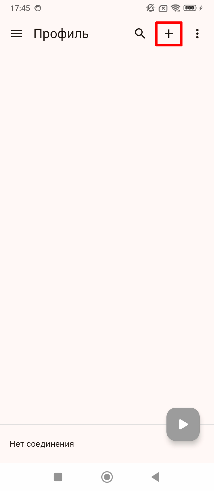
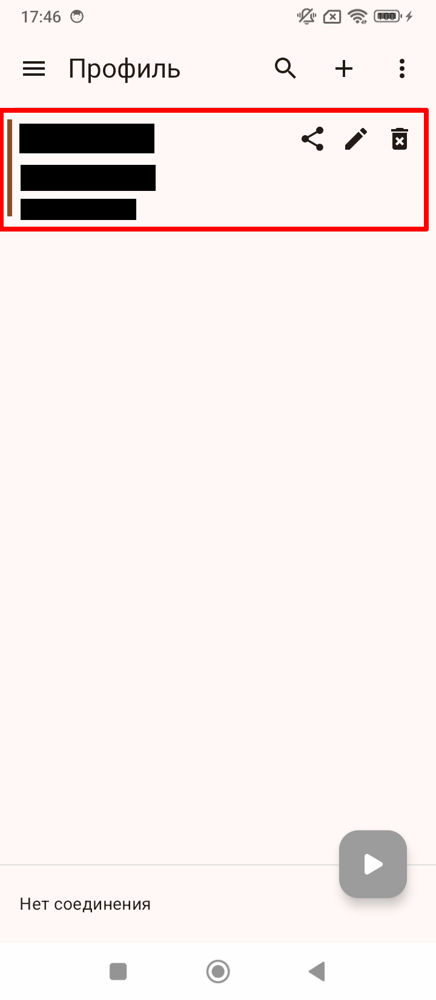
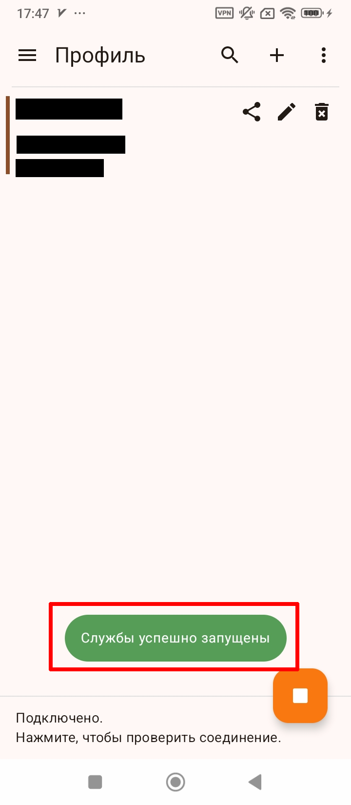

# Подключение на Android

[← На главную](../README.md)

Пошаговая инструкция для телефонов и планшетов с **Android 7.0 или новее**. Выполняйте шаги по порядку и не пропускайте ни одного.

_Проверено на версии v2rayNG 2.3.15 (ноябрь 2026)._

> [!IMPORTANT]
> Перед началом подготовьте **свой личный ключ** — QR-код для подключения. Эта инструкция ключи не выдаёт. Подробнее — в разделе [«Что понадобится»](../README.md#что-понадобится).

## Содержание

1. [Скачайте и установите приложение](#шаг-1-скачайте-и-установите-приложение)
2. [Обновите приложение](#шаг-2-обновите-приложение)
3. [Добавьте свой ключ](#шаг-3-добавьте-свой-ключ)
4. [Включите подключение](#шаг-4-включите-подключение)

Дальше: [после каждого включения телефона](#после-каждого-включения-телефона) · [не забывайте обновлять приложение](#не-забывайте-обновлять-приложение)

---

## Шаг 1. Скачайте и установите приложение

Нам понадобится **v2rayNG** — бесплатное приложение с открытым исходным кодом.

Откройте эту страницу **на телефоне**, найдите в таблице свой вариант и нажмите на ссылку.

| Ваш телефон | Ссылка |
|---|---|
| **Не знаете, какой у вас телефон** — этот вариант подходит для всех | **[⬇️ Скачать (universal)](https://github.com/2dust/v2rayNG/releases/download/2.3.15/v2rayNG_2.3.15_universal.apk)** |
| Современный 64-разрядный телефон (arm64) — так почти у всех телефонов последних лет | [⬇️ Скачать (arm64-v8a)](https://github.com/2dust/v2rayNG/releases/download/2.3.15/v2rayNG_2.3.15_arm64-v8a.apk) |
| Старый или очень недорогой 32-разрядный телефон | [⬇️ Скачать (armeabi-v7a)](https://github.com/2dust/v2rayNG/releases/download/2.3.15/v2rayNG_2.3.15_armeabi-v7a.apk) |

> [!TIP]
> Не уверены — скачивайте **первый вариант (universal)**. Он весит больше (около 70 МБ), но точно подойдёт.

Когда нажмёте на ссылку:

1. Браузер может предупредить, что файл может быть опасен. Нажмите **Скачать** (или **Всё равно скачать**).
2. Когда файл скачается, откройте его: нажмите на уведомление о загрузке или найдите файл в приложении **Файлы** (или **Загрузки**). Он называется **v2rayNG_2.3.15_…apk**.
3. Если телефон пишет, что установка из этого источника запрещена, — нажмите **Настройки**, включите **Разрешить установку из этого источника** и вернитесь назад.
4. Нажмите **Установить**.
5. Если появилось предупреждение Google Play Protect, нажмите **Подробнее** → **Всё равно установить**.
6. Нажмите **Открыть**. Если приложение попросит разрешение на уведомления, нажмите **Разрешить**.

> [!NOTE]
> На разных телефонах (Xiaomi, Samsung, Honor и других) названия кнопок могут немного отличаться, но смысл тот же.

Все версии приложения можно найти на [странице релизов](https://github.com/2dust/v2rayNG/releases), но обычно заходить туда не нужно.

---

## Шаг 2. Обновите приложение

**Зачем:** без свежей версии приложения ключи нового формата не работают, а новые версии выходят часто. Этот шаг не пропускайте.

1. Нажмите **☰** (три полоски) в левом верхнем углу.
2. Выберите **Проверить обновление** — откроется экран проверки.
3. Нажмите кнопку **Проверить обновление** на этом экране.
4. Посмотрите на результат:
   - «Установлена последняя версия» — всё в порядке, переходите к следующему шагу;
   - «Найдена новая версия» — нажмите **Обновить**. Скачается новый файл: установите его так же, как в [шаге 1](#шаг-1-скачайте-и-установите-приложение).

---

## Шаг 3. Добавьте свой ключ

**Зачем:** ключ — это ваши личные данные для подключения. Без него приложение не знает, куда подключаться.

Ваш ключ — это **QR-код**. Вместе с ним приходят и все нужные настройки, поэтому больше ничего настраивать не придётся.

1. Нажмите **+** в правом верхнем углу.

   

2. В появившемся меню выберите **Импорт из QR-кода**.
3. Дальше всё зависит от того, где у вас QR-код:
   - **QR-код на другом устройстве** (на экране компьютера, другого телефона или на бумаге). Нажмите на экран, чтобы включить камеру (если телефон попросит доступ к камере — разрешите), и наведите камеру на QR-код.
   - **QR-код на этом же телефоне** (например, его прислали в мессенджере). Сначала сохраните картинку с QR-кодом в галерею или сделайте снимок экрана. Затем на экране сканирования нажмите на **значок картинки** вверху справа и выберите эту картинку.

✅ **Должно получиться:** в списке появилась строка с вашим ключом.

> [!CAUTION]
> **Никому не пересылайте свой ключ** и не публикуйте его в открытом доступе. Ключ — как пароль: тот, у кого он есть, сможет пользоваться вашим подключением.

---

## Шаг 4. Включите подключение

1. Нажмите круглую кнопку **▶** в правом нижнем углу.
2. При первом подключении телефон спросит разрешение — появится окно **«Запрос на подключение»**. Нажмите **OK**.

✅ **Должно получиться:** появилась надпись «Службы успешно запущены», кнопка стала оранжевой с квадратиком, а внизу написано «Подключено».

**Проверьте, что всё работает:** нажмите на надпись «Подключено. Нажмите, чтобы проверить соединение.» внизу экрана. Через пару секунд появится «Соединение установлено за … мс» — значит, всё работает.

**Как выключить:** нажмите оранжевую кнопку с квадратиком.

---

## После каждого включения телефона

После перезагрузки или выключения телефона подключение нужно включить заново:

1. Откройте приложение **v2rayNG**.
2. Нажмите круглую кнопку **▶** в правом нижнем углу.

## Не забывайте обновлять приложение

Приложение часто обновляется. Без последних обновлений правильная работа не гарантируется.

Время от времени (например, раз в неделю) проверяйте обновления: **☰** → **Проверить обновление**, как в [шаге 2](#шаг-2-обновите-приложение).

[← На главную](../README.md)
