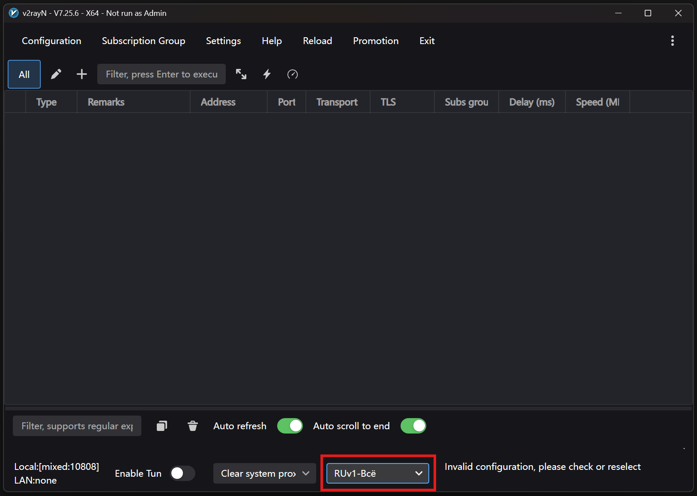
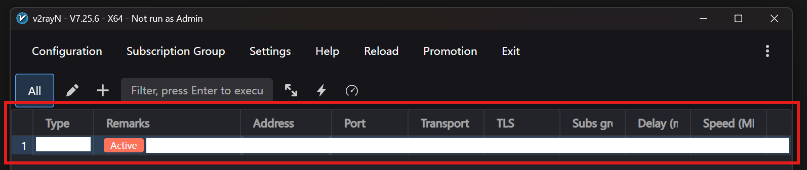
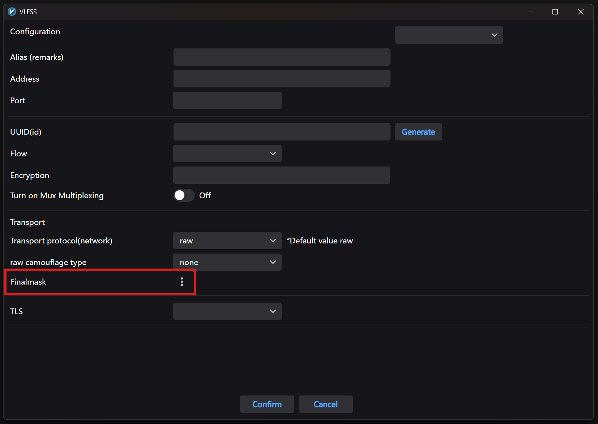
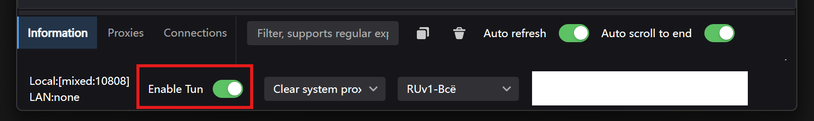

# Подключение на macOS

[← На главную](../README.md)

Пошаговая инструкция для компьютеров Mac (MacBook, iMac, Mac mini и других) с **macOS 13.6 или новее**. Выполняйте шаги по порядку и не пропускайте ни одного.

_Проверено на версии v2rayN 7.25.6 (ноябрь 2026)._

> [!IMPORTANT]
> Перед началом подготовьте **свой личный ключ**: ссылку или QR-код. Эта инструкция ключи не выдаёт. Подробнее — в разделе [«Что понадобится»](../README.md#что-понадобится).

> [!TIP]
> **Как нажать правой кнопкой мыши на Mac:** нажмите на тачпад двумя пальцами или щёлкните, удерживая клавишу <kbd>Control</kbd>.

## Содержание

1. [Скачайте программу](#шаг-1-скачайте-программу)
2. [Установите и запустите программу](#шаг-2-установите-и-запустите-программу)
3. [Обновите программу](#шаг-3-обновите-программу)
4. [Выберите настройки для России](#шаг-4-выберите-настройки-для-россии)
5. [Добавьте свой ключ](#шаг-5-добавьте-свой-ключ)
6. [Включите фрагментацию](#шаг-6-включите-фрагментацию)
7. [Включите подключение](#шаг-7-включите-подключение)

Дальше: [после каждого включения компьютера](#после-каждого-включения-компьютера) · [не забывайте обновлять программу](#не-забывайте-обновлять-программу)

---

## Шаг 1. Скачайте программу

Нам понадобится **v2rayN** — бесплатная программа с открытым исходным кодом.

Найдите в таблице свой Mac и нажмите на ссылку — скачивание начнётся само.

| Ваш Mac | Ссылка |
|---|---|
| **С чипом Apple** (M1, M2, M3, M4 и новее) — почти все Mac, купленные после 2020 года | **[⬇️ Скачать для Apple](https://github.com/2dust/v2rayN/releases/latest/download/v2rayN-macos-arm64.dmg)** |
| **С процессором Intel** — более старые Mac | [⬇️ Скачать для Intel](https://github.com/2dust/v2rayN/releases/latest/download/v2rayN-macos-64.dmg) |

<details>
<summary><b>Как узнать, какой у меня Mac</b></summary>

1. Нажмите на **значок яблока** в левом верхнем углу экрана.
2. Выберите **Об этом Mac**.
3. Посмотрите на открывшееся окно:
   - есть строка **Чип** и в ней написано «Apple M…» — вам нужен **первый** вариант;
   - есть строка **Процессор** и в ней написано «Intel» — **второй**.

В этом же окне указана версия macOS. Если она ниже 13.6 — сначала обновите систему.

</details>

Все версии программы можно найти на [странице релизов](https://github.com/2dust/v2rayN/releases), но обычно заходить туда не нужно.

---

## Шаг 2. Установите и запустите программу

1. Откройте папку **Загрузки** (в Finder) и дважды щёлкните по скачанному файлу **v2rayN-macos-arm64.dmg** (или **v2rayN-macos-64.dmg**, если вы скачали вариант для Intel).
2. Откроется окно установщика со значком **v2rayN** и папкой **Applications**. Перетащите мышью значок **v2rayN** на папку **Applications** и дождитесь окончания копирования.
3. Программа не подписана Apple, поэтому macOS не даст её открыть и скажет, что программа «повреждена». На самом деле это не так. Чтобы снять блокировку, один раз выполните команду в Терминале:
   1. Нажмите <kbd>⌘ Cmd</kbd> + <kbd>Пробел</kbd>, введите **Терминал** и нажмите <kbd>Return</kbd>.
   2. Скопируйте команду ниже кнопкой копирования (она появляется в правом верхнем углу блока, если навести на него мышь):

      ```sh
      xattr -cr /Applications/v2rayN.app
      ```

   3. Щёлкните в окне Терминала, вставьте команду (<kbd>⌘ Cmd</kbd> + <kbd>V</kbd>) и нажмите <kbd>Return</kbd>.
   4. В ответ ничего не появится — это нормально. Терминал можно закрыть.
4. Откройте в Finder папку **Программы** и дважды щёлкните по **v2rayN** — программа запустится.
5. Чтобы потом легко находить программу, закрепите её в Dock: нажмите **правой** кнопкой мыши на значок v2rayN в Dock (внизу экрана) → **Параметры** → **Оставить в Dock**.

> [!WARNING]
> **Запускайте программу из папки «Программы» или из Dock**, а не из окна установщика.

> [!NOTE]
> Если macOS всё равно пишет, что программа повреждена, — повторите команду из пункта 3, скопировав её целиком.

---

## Шаг 3. Обновите программу

**Зачем:** без свежей версии программы и её «ядра» ключи нового формата не работают. Этот шаг не пропускайте.

1. Посмотрите на верхнюю часть окна программы. Если там есть кнопка **New Update** — нажмите её.
   Если такой кнопки нет — откройте меню **Help** → **Check Update**.
2. В открывшемся окне нажмите **Check and Update**.
3. Подождите, пока всё скачается и обновится. Программа может сама перезапуститься — это нормально.

---

## Шаг 4. Выберите настройки для России

**Зачем:** программа скачает готовые настройки, подобранные для России.

> [!NOTE]
> Скриншоты в этой инструкции сделаны в Windows. На Mac окно программы выглядит так же, отличается только рамка окна.

1. Откройте меню **Settings** → **Regional presets setting** → **Russia**.
2. Подождите. Скачивание происходит не сразу и может занять несколько минут.
3. В самом низу окна найдите выпадающий список справа от **Clear system proxy** и выберите в нём **RUv1-Всё**.

   

> [!NOTE]
> - Если варианта **RUv1-Всё** в списке нет, значит, настройки ещё не скачались. Подождите ещё немного и откройте список снова.
> - Надпись «Invalid configuration, please check or reselect» внизу окна на этом шаге — это нормально. Она пропадёт, когда вы добавите ключ.

---

## Шаг 5. Добавьте свой ключ

**Зачем:** ключ — это ваши личные данные для подключения. Без него программа не знает, куда подключаться.

Ключ может быть у вас в виде **ссылки** (текст, который начинается с `vless://`, `vmess://`, `trojan://` или `ss://`) или в виде **QR-кода**. Выберите свой вариант.

### Вариант А: ключ-ссылка

1. Скопируйте ссылку **целиком**: выделите её и нажмите <kbd>⌘ Cmd</kbd> + <kbd>C</kbd>.
2. В программе откройте меню **Configuration** → **Import Share Links from clipboard**.
   Или просто нажмите <kbd>⌘ Cmd</kbd> + <kbd>V</kbd> в окне программы — результат будет тот же.

### Вариант Б: QR-код

- **QR-код открыт на экране** (например, в мессенджере). Сделайте так, чтобы он был виден на экране, и в программе выберите **Configuration** → **Scan QR code on the screen**.
- **QR-код сохранён как картинка.** В программе выберите **Configuration** → **Scan QR code in the image** и укажите файл с картинкой.

Если сканирование с экрана не сработало, сохраните QR-код картинкой и воспользуйтесь вторым способом. Сделать снимок части экрана можно так: <kbd>⌘ Cmd</kbd> + <kbd>Shift</kbd> + <kbd>4</kbd>, затем выделите QR-код мышью — картинка появится на рабочем столе.

✅ **Должно получиться:** в списке программы появилась строка с вашим ключом и пометкой **Active**.



> [!CAUTION]
> **Никому не пересылайте свой ключ** и не публикуйте его в открытом доступе. Ключ — как пароль: тот, у кого он есть, сможет пользоваться вашим подключением.

---

## Шаг 6. Включите фрагментацию

**Зачем:** эта настройка помогает подключению не попадать под блокировки.

1. Дважды щёлкните по строке с вашим ключом (или нажмите на неё **правой** кнопкой мыши и выберите **Edit**). Откроется окно настроек ключа.
2. Найдите строку **Finalmask** и нажмите кнопку **⋮** рядом с ней. Появится поле для текста.

   

3. Если в поле уже что-то написано — удалите это: щёлкните в поле, нажмите <kbd>⌘ Cmd</kbd> + <kbd>A</kbd>, а затем <kbd>Delete</kbd>.
4. Скопируйте код ниже. Проще всего — кнопкой копирования: она появляется в правом верхнем углу блока с кодом, если навести на него мышь.

   ```json
   {
     "tcp": [
       {
         "type": "fragment",
         "settings": {
           "packets": "tlshello",
           "lengths": ["10-20"],
           "delays": ["5-10"],
           "maxSplit": 6
         }
       }
     ]
   }
   ```

5. Щёлкните в поле и вставьте код: <kbd>⌘ Cmd</kbd> + <kbd>V</kbd>.
6. Нажмите **Confirm**, чтобы сохранить.

---

## Шаг 7. Включите подключение

1. В нижней части окна нажмите на переключатель **Enable Tun**.
2. Появится окно **System sudo password**. Введите пароль от вашего Mac — тот же, что вы вводите при входе в систему, — и нажмите **Confirm**.

✅ **Должно получиться:** переключатель **Enable Tun** стал зелёным. Готово — подключение работает.



> [!NOTE]
> - Если появилась надпись «Incorrect password, please try again», значит, пароль введён неверно. Введите его ещё раз.
> - Программа не запоминает пароль: после каждого перезапуска его нужно вводить заново.

**Как выключить:** нажмите на переключатель **Enable Tun** ещё раз — он станет серым.

---

## После каждого включения компьютера

После перезагрузки или выключения Mac программу нужно запускать заново:

1. Нажмите на значок **v2rayN** в Dock.
2. Нажмите на переключатель **Enable Tun** внизу окна.
3. Введите пароль от Mac и нажмите **Confirm**.

## Не забывайте обновлять программу

Программа и её ядро часто обновляются. Без последних обновлений правильная работа не гарантируется.

- Если вверху окна появилась кнопка **New Update** — нажмите её и обновитесь, как в [шаге 3](#шаг-3-обновите-программу).
- Даже если кнопки нет, время от времени (например, раз в неделю) проверяйте обновления вручную: **Help** → **Check Update** → **Check and Update**.

[← На главную](../README.md)
